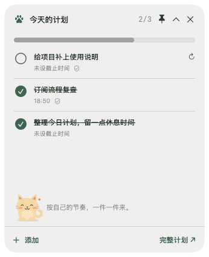

<p align="center">
  
</p>

<h1 align="center">Dayproof</h1>

<p align="center"><strong>给待办装了只猫，还能按约定的证据自动打勾。</strong></p>
<p align="center">原生 Mac 日计划 · 菜单栏与悬浮窗 · 本地代码验收 · MIT 开源</p>
<p align="center">A native macOS daily planner with a desktop cat and code-based task checks.</p>

<p align="center">
  <a href="https://github.com/airesearchjishengyin/dayproof/actions/workflows/ci.yml"></a>
  <a href="LICENSE">MIT License</a> ·
  <a href="https://github.com/airesearchjishengyin/dayproof/releases">源码版本</a> ·
  <a href="docs/user-guide.md">完整使用说明</a> ·
  <a href="https://github.com/airesearchjishengyin/dayproof/issues">反馈与建议</a>
</p>


> **早期源码预览版。** 当前需要自行构建，尚无签名、公证的安装包；不需要 App Store 或 Apple Developer 付费会员。截图使用独立演示数据，不代表真实账号、订阅查询或第三方应用连接。

## 一天怎么用

早上写下今天的任务、截止时间和“怎样才算完成”。工作时随时看菜单栏或置顶小窗；文件规则满足后自动打勾，需要自己判断的事情手动确认。年糕会在完成任务时陪你庆祝，没做完也不会扣分。

- **随时看计划**：原生 SwiftUI / AppKit 界面，菜单栏显示进度，悬浮窗可拖动、收起或取消置顶。
- **一点陪伴**：摸摸、喂小鱼干、安静模式，或导入本地 AgentPet / Petdex 宠物素材包。年糕是项目原创绘图。
- **按证据完成**：文件存在、原文匹配、JSON 状态、Markdown 清单等规则定时检查，保留验收记录。
- **让常用工具写计划**：提供 MCP 接口，设置中可复制 Codex / Claude Code 接入命令；不支持 MCP 的工具可对接本机 HTTP API。
- **后台检查不调用模型**：手动规划和代码验收无需 API key。自然语言生成计划可选接入 Ollama，需要你主动触发。
- **数据保存在本机**：SQLite 存储，支持导出 JSON。连接外部 AI 客户端或远程 Ollama 时，相关数据处理取决于你的配置。

<p align="center">
  
  
</p>

## 从源码启动 Mac 桌面版

需要 Git、Node.js 22+、npm、Python 3 和 Apple Command Line Tools。界面最低目标为 macOS 13；目前只在 Apple Silicon Mac 上实测，Intel 和其他系统版本未实测。**不需要安装完整 Xcode，不需要打开浏览器。**

```sh
git clone https://github.com/airesearchjishengyin/dayproof.git
cd dayproof
npm ci
npm run desktop:build
open build/Dayproof.app
```

如果尚未安装 Apple 编译工具，先运行 `xcode-select --install`，按系统提示完成后再构建。构建会下载 npm 依赖，并把本机 Node 运行时与后端打包进 `.app`；这些命令用于在自己的 Mac 上构建早期版本。

首次使用可在“工具与设置”选择证据目录，并复制 MCP 接入命令。任务数据默认保存在 `~/Library/Application Support/Dayproof/data/`。关闭主窗口后菜单栏和检查继续运行；从菜单栏退出或电脑休眠时停止检查。旧版开发服务若占用 `4317`，需先退出。

## 哪些事能自动打勾

| 任务例子 | 当前能检查的条件 |
| --- | --- |
| 项目阶段开发完成 | README 中事先约定的条目均已勾选 |
| 保存一份交付文档 | 指定文件存在，或包含指定原文 |
| 外部工具更新任务状态 | JSON 指定字段严格等于预期值 |
| 整理 10 篇论文笔记 | 指定论文和约定笔记结构齐全，默认还需人工确认 |
| 写好申请邮件草稿 | 约定收件人、主题和基本正文结构齐全，默认还需人工确认 |
| 看电影、取快递、掌握课程内容 | 手动确认 |

文件规则只证明你约定的条件。README 勾选不等于代码经过独立测试，笔记齐全不等于读懂论文，邮件草稿也不等于已发送。需要语义判断或暂时无法取得数据时，交给用户确认。后台不循环调用 LLM 或 decision model。

默认每项自动任务每 5 分钟检查，可修改间隔或立即检查；应用运行且电脑未休眠时生效。详见[六类日常任务实例](docs/verification-examples.md)。

## 文档与参与

- [完整使用说明](docs/user-guide.md)：模型规划、MCP、HTTP API、数据备份和规则边界。
- [架构说明](docs/architecture.md)：任务、调度、证据、状态与客户端如何协作。
- [Verifier 项目综述](docs/verifier-review-2026-10-19.md)：项目调研与低成本验收取舍，非产品已实现能力清单。
- [贡献指南](CONTRIBUTING.md)：开发、测试与问题反馈。
- [小红书宣传文案](docs/xiaohongshu-launch.md)：发布草稿，尚未对外投放。
- [第三方许可](THIRD_PARTY_NOTICES.md)：复用 AgentPet 图片切片模块，保留 MIT 许可；导入素材按作者许可使用。

欢迎提 issue：告诉我们你希望哪一种任务能自动打勾，并附一个不含隐私的证据示例。请勿上传账号令牌、私人任务数据库或真实工作材料。

```sh
npm run build          # 类型检查与前端构建
npm test               # 代码验收、HTTP、SQLite、调度与 MCP
npm run desktop:test   # 构建桌面版后，以隔离数据检查原生界面和退出清理
```

当前以 GitHub 开源和源码构建为主。下一步考虑改善安装体验、增加常用证据连接器和多条件规则；App Store 上架暂缓。[此前发布评估](docs/app-store-readiness.md)仅作为技术记录保留。

[MIT](LICENSE) · 如果这个小工具对你有用，欢迎 Star 或分享，也欢迎贡献代码。
