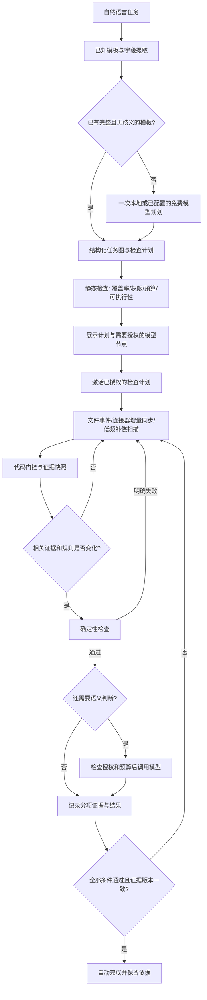

# 自适应 Agent Verifier：设计提案

状态：架构提案；本文所述的编译器、连接器、预算、事件缓存尚未实现。**最新实现选择纯代码验收，旧 LLM 验收已停用**；不能由下文可选模型架构推断当前后台会调用模型。当前能力见 [六类任务实例](verification-examples.md)，历史架构保留供参考。

**产品优先级修订：** 先按 [Work Plan 轻量验收策略](work-plan-verification-policy.md) 实施。任务创建时选择代码、decision model 或手动路径，并固定用户接受的依据强度；不要求每个任务进入本文的完整任务图。README 声明可以是用户明确认可的完成依据，看电影等任务默认手动。本文后续的严格版本绑定与组合验收作为可选扩展，不作为首版接入门槛。

后续调研：[桌面 / 办公 Agent Verifier 开源调研（2026-10-19）](verifier-landscape-2026-10-19.md)。OpenComputer、CUA-Gym、DocOps 等已有直接相关工作；本设计应优先复用其经过适配的检查原语，不能以“LLM 生成桌面 verifier 用于 RL”笼统主张创新。

深入比较：[Agent Verifier 源码综述](verifier-review-2026-10-19.md)。其中区分 Jev 类决策模型与生成式 JSON judge，补充 Prime `DecisionJudge`/Clef 等现有实现，以及对现有 Dayproof 验收核心的保留与修改建议。当前 Ollama 路径仍是生成式模型，尚未集成这些决策后端。

## 1. 目标与边界

用户用自然语言指定目标、可接受的完成依据，以及需要时的产物位置、接收人和验收条件。系统优先选择已有配方，用尽可能少的模型调用确认是否满足约定。不存在证据渠道、内容含糊或权限不足时，可以转为手动确认，不推测自动完成。

“完备”指检查计划覆盖用户的所有验收条件，且每项都有证据来源或明确标记为不可自动验证；不是承诺能观察全部电脑操作或保证语义判断永远正确。

核心优化：**模型按需编译一次，确定性运行时反复执行，语义检查按证据版本付费/消耗算力。**

在此之前增加轻量策略路由：明确模板直接配置；含糊任务才使用一次 decision model 选择候选或生成式模型填参。路由决定“用谁验、验到什么程度、何时验”，不在每轮检查时重新调用。手动模式不启动自动验收；仅收集依据模式保留用户最终确认权。

## 2. 两条执行路径

规划不能擅自删掉困难条件来使任务更容易验证。缺失路径、稳定接收人 ID、发送渠道等关键参数时，只询问缺失项；不凭昵称猜测。

## 3. 检查计划采用受限 DSL

模型优先输出 JSON 检查计划，不输出直接运行的 Python/Shell。模板库提供经过测试的能力，例如：

- `file.snapshot`：检查指定路径，等待写入稳定，计算字节哈希，产生不可变快照。
- `document.extract`：调用固定的 TXT/Markdown/DOCX/PDF 解析器，保留段落/页码与原始文件哈希。扫描 PDF 才进入已授权的 OCR。
- `document.structure`：检查格式、章节、必需字段等硬条件。这只能证明结构存在。
- `semantic.rubric`：对指定快照逐项判断，返回结论、原文片段、位置和无法验证的条件。
- `message.find_outgoing_attachment`：通过特定应用的只读连接器读取真实出站消息与附件记录。
- `all`、`any`、依赖与证据绑定：组合节点，不提供任意循环、任意网络地址或 shell。

每个节点声明输入、输出、读取范围、依赖、失效条件、成本类别。编译器拒绝未知操作、依赖环、未覆盖验收条件、越权路径与未获授权的运行时模型节点。任务内容和证据永远是数据，不能修改执行器权限。

长尾需求确实需要新代码时，作为“新验证器插件”单独生成、审查并用正反例测试后注册。运行时插件采用受限进程、资源限制及可枚举的文件/网络权限；不能把 Node 子进程本身当成安全沙箱。这条扩展路径不阻塞已有模板的快速创建。

## 4. 会议纪要例子：任务图与证据绑定

输入示例：将纪要保存到用户指定的 DOCX 路径，形成可落地技术方案，然后通过 Telegram 发给指定老板。

### A：完成纪要及技术方案

1. 文件检查：路径存在、格式可解析、写入稳定。采集哈希 `H` 与快照。
2. 解析：提取正文与段落定位，不执行宏或文档内指令。
3. 代码检查：必需结构，如技术方案、实施步骤、负责人、时间安排、验收方法。
4. 语义检查：仅当用户明确要求这些内容具有实际意义时，判断方案是否与会议目标相关、步骤是否具体、是否有明显占位文字。标题齐全不能代替这一步。
5. 输出：逐条件 `pass / fail / unknown` 和对应片段。引用必须能在本次提取内容中定位；不能把存在引用视为语义一定正确。

如果未提供会议原始记录，系统可以判断文档是否包含指定方案，不能证明纪要忠实于会议。若用户把准确性列为条件，则还需原始记录作为另一个输入，否则该条件为 `unknown`。

### B：发送该版本给老板

1. 解析并确认稳定的 Telegram 接收人 ID；同时限制发送账号、对话、消息方向与时间窗口。
2. 查找真实服务器返回的出站消息，确认消息未处于失败/待发送状态。
3. 将附件与 A 验收的版本 `H` 绑定。文件名相同不能证明内容相同；需要可读附件字节哈希，或已有发送器保存且可独立核对的附件关联。
4. 若附件无法读取/关联，保持 `unknown`，不以相同名称或一张发送截图自动通过。
5. 全部条件通过才完成 B。B 不需要再让 LLM 阅读对话历史。

A、B 是依赖任务，父任务要求 A 和 B 都通过。若发送发生在 A 验收前，只要最终绑定的是同一个 `H`，仍可通过；无需机械要求操作顺序。

“已发给领导审阅”不等于“领导已读”或“领导批准”。只有用户要求后两者时，才增加独立条件。Verifier 只读检查，不代替用户发送消息。

Telegram 的 Bot API 并不提供任意个人账号全部历史的读取能力；需要确认消息是否经过该 bot、连接器能读哪些记录。若需要用户账号会话，应单独配置对应只读集成与范围。连接器不可用时，任务进入 `blocked`，不能伪装成连接成功。

## 5. 低成本执行与缓存

- **事件驱动**：文件写入事件先去抖和等待稳定，再取快照；消息通过增量游标同步。保留低频全量补偿，处理事件丢失、离线与监听溢出。
- **门控**：文件不存在、解析失败、硬条件不满足时不调用语义模型。昂贵节点只在所有前置条件满足后运行。
- **缓存键**：验收条件版本、检查节点/提取器/提示词版本、模型及参数、相关输入哈希、任务绑定信息。相同输入复用语义结论，任务之间不能错误共享身份相关结果。
- **变化范围**：文件 mtime 改变但字节未变，不重跑。正文变化才重跑语义节点。消息未变化，不重读全部历史。
- **通过前校验版本**：完成写回时核对任务修订号及依赖快照。检查旧版本不能完成修改后的任务。A 的活动草稿变动时旧结果标记过期；已交付的版本与发送记录作为历史快照保留。
- **失败处理**：未满足的结论可按同一证据版本缓存；超时/限流属于错误，有限次退避重试，不永久缓存成失败，也不无限循环请求。
- **停止条件**：完成后停止周期检查；重新打开或变更验收条件才重新激活。耗尽预算后暂停模型节点，代码检查可继续。

例子：每 5 分钟检查一次、运行 8 小时，会产生约 96 次轮询。若文档只有 3 个稳定正文版本，语义判断目标可降到每个不同版本至多一次，即最多约 3 次成功判断；错误重试另受预算限制。这是条件示例，不是已实测结果。

## 6. 规划速度与小模型能力

按固定顺序处理：模板命中 → 字段补全 → 一次受约束的模型规划 → 代码静态校验。

模型只需做分类、槽位提取和有限操作选择。例如“文档交付 + 发消息”映射到现有任务图，再填路径、接收人、验收条目。无需每次从零编写连接器、文件解析器或完整程序。

同时包含多类任务时返回组合 DAG，不强制每个任务只能属于一类。用户可先看到即时模板草稿；缺失项补全与语义规划异步更新，激活前版本固定。规划输出不合法时最多有限次修复，再显示不能自动配置的具体原因。

复用的是用户已认可的结构和参数化规则，不盲目复用上次模型的判断。可用小模型抽取字段，用较强本地模型处理少量复杂拆解；是否升级远程模型由用户策略决定，不自动触发付费回退。

## 7. 模型调用授权与预算

规划阶段和运行阶段使用两份独立策略。用户让模型生成验收器，不代表授权验收器在后台无限调用模型。

激活计划时，只要含运行时模型节点，就展示：调用目的、后端/模型、触发条件、将读取或上传哪些证据、频率限制、每日/总次数、每次输入上限以及付费上限。**本地节点同样提示并授权**，因为它消耗 CPU/GPU、内存、电量与时间。

建议初始模板：相关内容变化才调用，最短间隔 2 分钟，每任务每日最多 5 次尝试，总计最多 10 次，每次最多 8,000 字符；用户可调整。这些是待实测的初始值，不能静默截断长文后仍宣称完整验收。超长文档进入显式分块策略，子调用也计入预算。

授权按“任务修订版 + 验收节点 + 后端 + 数据范围 + 预算”保存。在范围内无需逐次弹窗；提高预算、增加读取范围或从本地切换到远程时重新授权。撤销后立即阻止后续模型调用。调用前持久化预留额度，成功、超时、失败都计为尝试，重启不重置次数；平台免费额度与本地预算同时约束。

OpenRouter 可以作为可选后端；只允许明确配置的免费模型，不自动切换付费路由。免费可用性不保证，遇到限流或额度耗尽就退避/暂停。证据传往远程需要明确的数据授权；“免费”不能代替该授权。不要承诺始终免费、始终可用。

界面文案示例：

> 此任务需要本地模型判断技术方案是否具体。仅正文变化时触发，每日最多 5 次尝试、总计最多 10 次，每次最多 8,000 字符。正文只交给本地服务；不自动切换远程。达到上限后暂停判断。是否启用？

## 8. 语义可靠性与小型 Decision Model

把语义问题收窄成可回答的小判据，例如“是否给出了实施步骤与可检验的完成条件”，通常比“这份方案好吗”更适合小模型。每项返回 `pass / fail / unknown` 与位置化证据，用户可以查看自动完成的理由。

模型自报的 0.95 不是 95% 准确率，也不应作为通用自动完成门槛。上线前使用人工标注的正反例、相似但不符合的文档、占位符与提示注入样本进行验收，重点测量错误打勾率、人工复核率、延迟与调用次数。高歧义任务保持待复核。

以后有足够且合法收集的分领域标注数据时，可训练轻量分类器或用 embedding/特征判断稳定子问题。它适合重复的固定领域，不能直接承担任意自然语言任务的通用语义验证。首次版本先用代码 + 小范围本地 LLM，积累真实错误样本后再决定是否训练专用模型。

## 9. 状态与审计

节点状态：`pending`（条件尚未满足）、`pass`、`fail`（明确不符）、`unknown`（证据不足）、`error`（技术故障）、`blocked`（缺参数/权限/预算）。父任务只在全部必需节点通过时完成。

每次结果保存任务/计划版本、输入哈希、证据来源与定位、连接器版本、检查器版本、模型/提示词版本、调用计数和结果。另存策略模式、用户接受的依据类型及完成来源；`manual` 是验收路径，用户确认后任务为已完成，不是验证失败。敏感令牌不写审计日志，证据按本地保留策略存储。审计能解释判定来源，不能把第三方页面文字本身升级为可信账户证明。

## 10. 从现有 Dayproof 演进

已具备：本地 SQLite、证据根目录约束、文件/JSON 单项规则、Ollama、定时调度、任务修订冲突检查和基础事件日志。

首版先实施轻量策略文档中的固定模式、README 模板、模型缓存/预算和一次性路由。以下保留为后续严格验收扩展顺序，避免同时改原生前端、执行器和多平台集成：

1. **执行基础**：版本化检查计划、组合 DAG、证据快照与缓存、模型预算/授权持久化；新增接口而不改变现有单项规则语义。
2. **首个闭环**：文件/DOCX/Markdown 解析 + 结构检查 + 已授权的本地语义节点；原生界面展示各节点结果、授权与剩余额度。
3. **模板编译**：自然语言到模板/DSL，缺参数提问，静态校验，跨任务复用模板。
4. **真实外部证据**：先做一个只读发送记录适配器，验证身份、附件版本绑定、分页/游标与离线重连；再扩展 Telegram 等渠道。
5. **可选模型后端及插件**：在统一授权/预算边界内加入免费远程后端；长尾代码插件后置。

首批关键测试：证据不变不重复调用；文件变化只失效依赖节点；旧版本无法完成新任务；模型无授权/预算耗尽时绝不发请求；重启不重置预算；同名不同附件不能通过发送检查；发送成功不误判为已读/批准；规划不能静默丢弃原始条件；证据中的指令不改变检查计划。

本提案未新增实际 Telegram 连接、远程模型配置或后台任务。当前单项 LLM 规则尚未实现上述缓存和预算能力，不能把提案当作已上线的行为。
