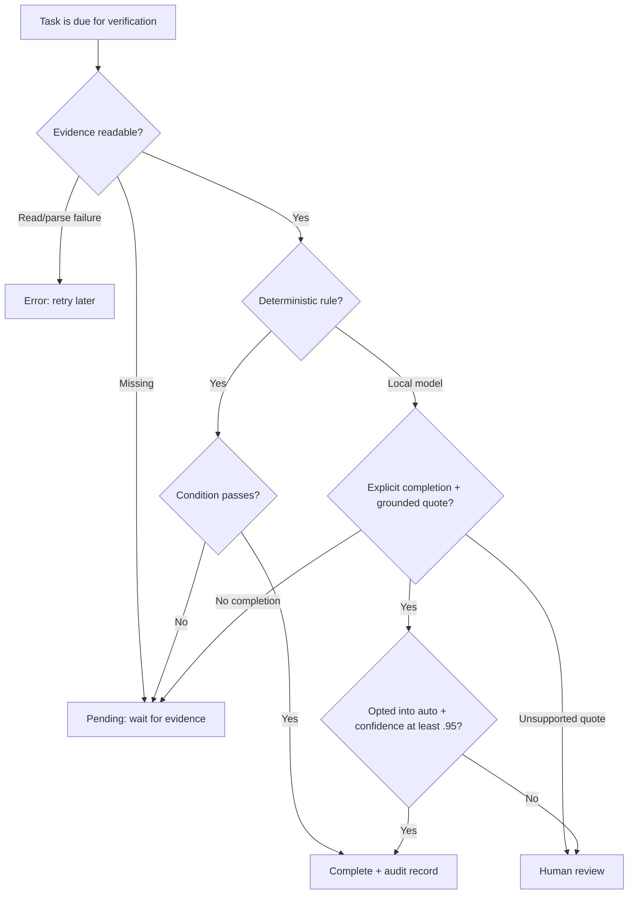

# Architecture and acceptance decisions

Browser → same-origin REST → SQLite. MCP STDIO → authenticated loopback REST → the same store. Both paths use the same Zod validation. The browser is optional for background checks.

The process scheduler scans every ten seconds. It considers unfinished non-manual tasks whose plan date has arrived and next-check timestamp is due. Checks are serialized by the scheduler, and concurrent manual calls for the same task share one in-flight promise. Results carry a task revision: a check started before editing or manual completion/reopening cannot overwrite a newer revision. Failures store an explicit error and schedule a retry. No deadline-based inference of success.

Model confidence is self-reported and is not calibrated accuracy. A matching quote establishes traceability, not truth. All file rules assume the configured producer is trustworthy; an agent-created status file is not an independently verified bank, billing, or account record. Deterministic rules prove only their specific condition, so choose conditions that actually represent the task.

Evidence paths are resolved and checked against a canonical EVIDENCE_ROOT, including symlinks. No generic shell execution, arbitrary URL checks, automatic credential scraping, or browser monitoring. Local evidence filesystem changes can still race with reads; this is a personal local application, not a hostile multiuser sandbox.

Stored events are bounded to 500; UI returns the latest 50. SQLite uses WAL and synchronous transactions for batch creation. Model settings persist in SQLite; connection endpoints are server environment settings. Browser imports and MCP writes accept plan data only, never caller-supplied completion status.

The MCP bridge reads a local token with an absolute DATA_DIR and needs the main server to be running. It intentionally does not open the SQLite file directly so writes and scheduling remain centralized. Existing coding agents can write plans without needing an additional inference provider in Dayproof.
