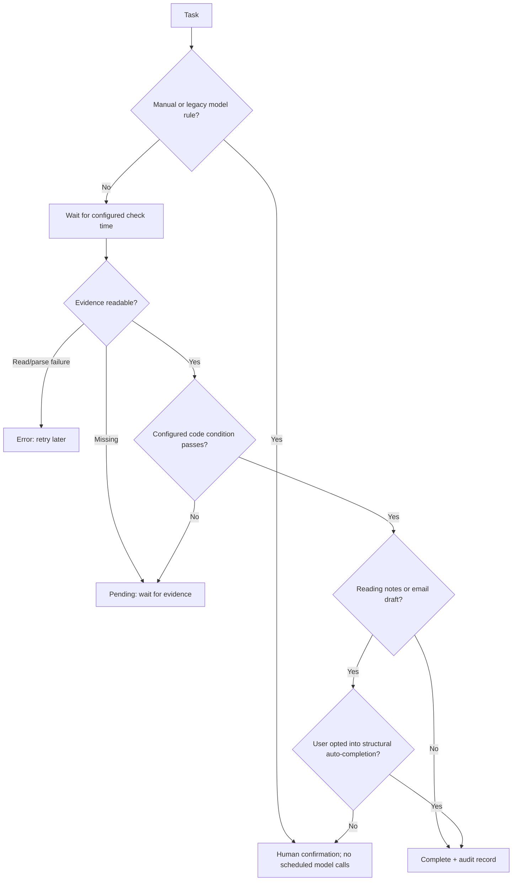

# Architecture and acceptance decisions

Native SwiftUI/AppKit interface → authenticated loopback REST → SQLite. The app owns the bundled Node backend and stops it on quit. MCP STDIO → authenticated loopback REST → the same store. The optional browser development UI uses same-origin REST. All paths use the same Zod validation; daily desktop use does not require a browser.

The process scheduler scans every ten seconds. It considers unfinished non-manual tasks whose plan date has arrived and next-check timestamp is due. Checks are serialized by the scheduler, and concurrent manual calls for the same task share one in-flight promise. Results carry a task revision: a check started before editing or manual completion/reopening cannot overwrite a newer revision. Failures store an explicit error and schedule a retry. No deadline-based inference of success.

Background verification uses code only. Legacy model rules return human review and are not scheduled; no local or cloud model is called to judge completion. Reading-note and email-draft checks require human confirmation by default; the user may explicitly accept structural checks as the completion condition. All file rules assume the configured producer is trustworthy; an agent-created status file is not an independently verified bank, billing, or account record. Deterministic rules prove only their specific condition, so choose conditions that actually represent the task.

Evidence paths are resolved and checked against a canonical EVIDENCE_ROOT, including symlinks. No generic shell execution, arbitrary URL checks, automatic credential scraping, or browser monitoring. Local evidence filesystem changes can still race with reads; this is a personal local application, not a hostile multiuser sandbox.

Stored events are bounded to 500; UI returns the latest 50. SQLite uses WAL and synchronous transactions for batch creation. Ollama is optional and only generates editable plan drafts on explicit user request; startup/model-list refresh may query its available models. Model settings persist in SQLite; connection endpoints are server environment settings. Plan imports and MCP writes accept plan data only, never caller-supplied completion status. External AI clients use their own providers and may send information they read to those providers.

The MCP bridge reads a local token with an absolute DATA_DIR and needs the main server to be running. It intentionally does not open the SQLite file directly so writes and scheduling remain centralized. Existing coding agents can write plans without needing an additional inference provider in Dayproof.
