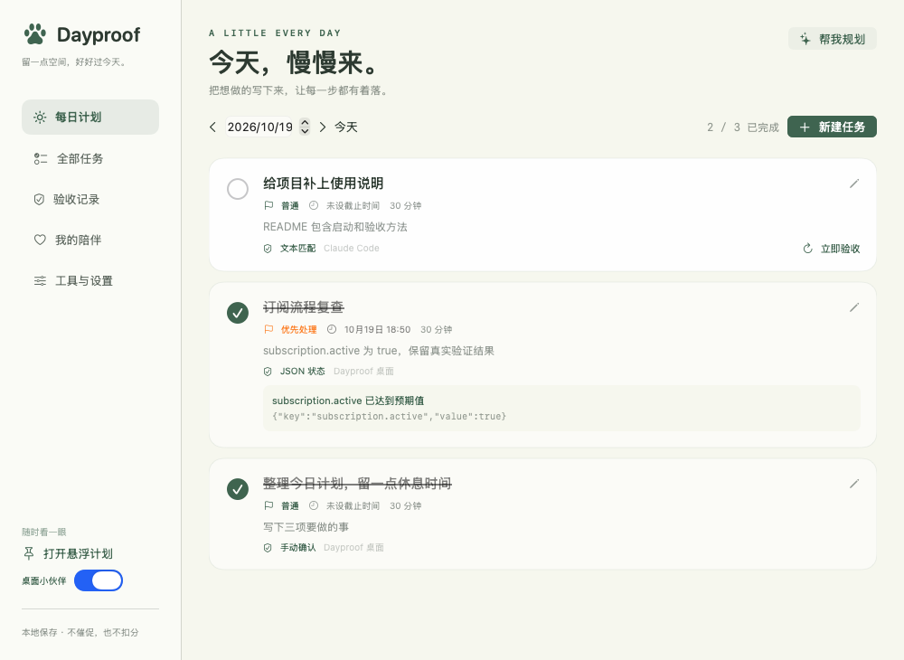

# Dayproof 使用与技术说明

**一个知道“怎样才算完成”的每日工作计划。**

每天早上写下任务、deadline 和验收标准；工作时让 Codex / Claude Code 直接写入计划；完成后用证据检查，而不是只听 AI 说“做完了”。界面为中文，本地 SQLite 存储，MIT 许可。

> v0.2.0 增加原生 macOS 桌面应用、菜单栏进度、置顶悬浮计划和桌面小伙伴。任务仍在本机 SQLite 保存。



截图为独立测试数据，展示界面和规则检查，不代表真实账号或订阅状态。

应用图标复用桌宠“年糕”的同一份 SwiftUI 原生绘图，构建时生成 macOS `.icns`：


## 先说结论：市面上有类似产品

调查日期：2026-10-19。不能证明市场上不存在完全相同产品；下面是已核对的相近方案。

| 方案 | 适合什么 | 与本项目目标的差异 |
| --- | --- | --- |
| [Todoist + 官方 MCP](https://github.com/Doist/todoist-mcp) | 成熟日常任务管理，让 Claude Code 等 AI 创建、修改任务 | 官方 MCP 已支持任务读写与完成，但查阅资料未确认内置任意本地证据的定时验收。可另接自建检查器 |
| [Motion](https://www.usemotion.com/) | AI 任务生成、优先排序、日历排程、项目状态管理 | 官方介绍有状态管理和自动工作流，但未确认能直接核验 Claude Code 订阅或任意 harness 的本地结果 |
| [Sunsama](https://www.sunsama.com/) | 晨间规划、合理工作量、跨任务工具整理 | 更偏每日规划与日历体验；查阅资料未确认本项目要求的跨 AI 工具证据验收 |

如果只想最快投入日常使用，**Todoist + 官方 MCP + 小型验收脚本**值得优先考虑。Dayproof 作为本地、可开源的替代方案，重点是“验收标准 → 证据 → 自动检查 → 可追溯完成”。不是声称市面上没有计划软件。

## 桌面版（macOS 13+）

```sh
npm install
npm run desktop:build
open build/Dayproof.app
```

这是 SwiftUI / AppKit 原生应用，不在浏览器中显示。首次启动会把仓库 `data/` 中的 SQLite 数据安全复制到 `~/Library/Application Support/Dayproof/data/`，原数据不删除；应用关闭主窗口后继续运行定时验收，从菜单栏退出才会停止。旧版网页服务如仍占用 `4317`，请先退出后再启动桌面版。

菜单栏爪印显示今日进度；置顶小窗可拖动、收起或取消置顶；桌宠可以拖动、摸摸和喂小鱼干，也可安静或隐藏。内置“年糕”是本项目绘制的原创形象，没有惩罚或饥饿机制。可以在设置里导入本地 AgentPet / Petdex `pet.json` 和精灵图素材；素材许可由素材作者决定。应用附带本机 Node 运行时和后端，无需打开浏览器或预先启动网页服务器。当前构建为本机临时签名，开源发布包还需按发行渠道签名和公证。Mac App Store 另需沙盒与 Xcode 发布流程；当前后端和文件授权架构尚不具备直接提交条件，详见[发布评估](app-store-readiness.md)。

### 桌宠项目调研与复用

- [AgentPet](https://github.com/ntd4996/agentpet)：MIT 的原生 SwiftUI 菜单栏宠物，支持本地精灵素材包。我们复用了它的 `SpriteSlicer` 图片切片模块并保留上游署名和许可证；项目 README 说明宠物素材不随代码捆绑，素材包需遵守各自作者的许可。
- [BongoCat](https://github.com/ayangweb/BongoCat)：Apache-2.0 的跨平台桌面猫，主要对键盘、鼠标、手柄动作作出反应。Live2D 模型/素材需要单独核对授权，所以没有直接打包模型。
- [VPet](https://github.com/LorisYounger/VPet)：Apache-2.0 的 Windows 桌宠，提供互动和照料玩法；其 WPF 技术栈不适用于原生 macOS 界面。

因此 Dayproof 采用原生绘制的轻量“年糕”作为默认形象，并兼容 AgentPet/Petdex 风格的本地素材导入。没有自动从网络下载角色素材，避免把开源代码许可误当成美术授权。

在“工具与设置”复制 Codex 或 Claude Code 的 MCP 命令，粘贴到对应终端执行即可。应用不会修改全局 AI 客户端配置；其他 harness 是否支持取决于它的 MCP 能力。

## 网页开发版（Node.js 22+）

```sh
npm install
npm run build
npm start
```

打开 **http://127.0.0.1:4317**。此模式用于开发和浏览器预览；日常桌面使用请启动上面的 `.app`。

无需任何 API key。数据保存在项目 `data/dayproof.sqlite`。默认时区 `Asia/Shanghai`，服务仅监听 `127.0.0.1`。

可选配置：

```sh
PORT=4317 TZ=Asia/Shanghai \
EVIDENCE_ROOT=/absolute/path/to/evidence \
DATA_DIR=/absolute/path/to/dayproof/data \
npm start
```

`.env.example` 只供参考，程序**不会自动读取 .env 文件**，请通过 shell 设置环境变量。`EVIDENCE_ROOT` 目录需事先创建，默认是启动目录。证据文件只能在该目录及其子目录内，符号链接也会检查真实目标。文件内容检查上限 32 KB。

## 第一天怎么用

1. 新建任务，设置计划日期、截止时间（按界面所示时区）、优先级和预估时长。
2. 写清“怎样才算完成”。例如：“账号显示订阅激活，且付款凭证可核对”。
3. 选择验收方式。暂时无法读取真实状态的任务使用手动确认；完成后点击左侧方框。
4. 或点击“开始规划”：一行一任务完全离线；Ollama 可将自然语言拆解成草稿。确认草稿后才写入数据库。
5. 在“验收记录”核对结果和证据。之前日期未完成的任务在看板提示，可到“全部任务”编辑日期继续安排。

### 验收方式（后台只运行代码）

| 模式 | 自动完成条件 | 典型用途 |
| --- | --- | --- |
| 手动确认 | 用户勾选 | 电话、线下事项、暂无可读证据 |
| 文件存在 | 普通文件真实存在 | 约定的交付文件（仅证明存在，不证明质量） |
| 文本匹配 | 文件包含指定的原文 | 工具输出的明确完成标记 |
| JSON 状态 | 字段值与预期 JSON 原始值严格相等 | 结构化状态文件；`true` 不等于字符串 `"true"` |
| 进度清单 | 指定的 Markdown 条目均唯一存在且勾选 | 课程、README 阶段进展；按声明验收 |
| 论文笔记 | 每篇指定论文有结构达标的笔记；默认最终手动确认 | 不检查阅读理解或“最新”属性 |
| 邮件草稿 | 约定收件人、主题和纯文本正文结构达标；默认最终手动确认 | 不判断申请质量、不检查附件、不发送 |

笔记与邮件只有在用户明确接受结构条件并开启自动完成时才自动打勾。旧本地模型验收规则保留兼容读取，但不再调用模型，也不参与定时检查。参见 [六类日常任务实例](verification-examples.md)。

代码规则通过后按任务设置打勾或待确认；证据不足保持待办；需要理解内容时由用户确认；读文件失败记为错误。**deadline 只用于规划和逾期提示，不意味着完成。**

每项任务可设置 1–1440 分钟检查间隔（默认 5 分钟）；新建或编辑后的自动任务会在下一个调度周期首次检查。调度器每 10 秒扫描到期任务，按顺序执行，不调用模型；文件读取耗时不固定，因此不是硬实时系统。未来日期任务在其计划日开始自动检查；过去日期的未完成任务继续检查。可以手动触发立即检查。

关闭网页或桌面主窗口后检查继续，前提是 **Dayproof 服务仍在运行、电脑没有休眠**。退出服务/休眠时停止检查，下次启动补查。当前版未安装开机启动项。

编辑任务会清除先前验收及完成状态。正在进行的旧检查不会覆盖新的任务版本或手动操作。已完成任务不持续复验，重新打开后恢复检查。已有文件同样会通过存在/文本/JSON 规则；为每天或每次操作使用独立证据文件，避免误用旧结果。

### “完成 Claude Code 订阅”的例子

软件无法仅凭任务标题知道账户是否订阅成功，也不会替你购买或绕过登录。

可靠做法是：通过已登录工具、官方可用接口或人工核对得到真实状态，然后产生专用于这次任务的证据，例如：

```json
{"subscription":{"active":true},"verifiedBy":"manual-account-check","checkedAt":"2026-10-19T10:30:00+08:00"}
```

任务中选择 JSON 状态，文件路径填 `subscription-2026-10-19.json`，字段 `subscription.active`，预期值 `true`。文件写入真实证据目录后，定时器会检查并自动打勾。**这是证据格式示例，不代表已经检查你的订阅；AI 自行写入 true 也不能成为独立证明。**

首版不读取所有应用聊天记录，不偷取 session，也没有现成的 Claude 订阅状态连接器。可以后续增加受信任的官方状态 API、GitHub PR/CI 连接器及可配置多个条件的规则。

## 本地模型生成计划（可选，不用于验收）

先安装 [Ollama](https://ollama.com/)，运行服务并下载与你机器兼容的模型，例如：

```sh
ollama pull qwen3:4b
ollama serve
```

若 Ollama 桌面程序已启动，则不必重复 `serve`。在网页“模型与设置”选择实际安装的模型。默认 `qwen3:4b`；环境变量 `OLLAMA_MODEL` 可设置初始值，界面保存的设置优先。`OLLAMA_URL` 默认 `http://127.0.0.1:11434`。

程序通过 Ollama `/api/chat` 发送 JSON Schema 格式要求。只在用户主动生成计划时调用模型，返回可编辑草稿；后台验收不向模型发送证据。默认不访问任何付费 API；本地运行没有按次 API 费用，但需要硬件和电力。若自己将 `OLLAMA_URL` 指向远程服务，主动提交的规划目标会发送至该服务。云端“免费额度”不保证长期可用，因此未内置免费云端提供商。

**历史模型实验（验收路径现已停用；2026-10-19）：** 模拟服务覆盖成功、失败、低置信度、无依据引用分支。另用本机已有 `qwen2.5:0.5b` 实测：带明确 ISO 截止时间的单任务草稿约 5.8 秒返回；一份临时文本的语义验收约 0.45 秒返回“待人工确认”，引用与原文一致。这只是两个样例，不代表准确率。小模型另一份草稿的日期格式被校验拒绝；`qwen3.5:9b` 在本机一次生成超过 90 秒被中止。当前本机设置选择已安装的小模型，开源默认值仍为 `qwen3:4b`，首次使用请按实际安装情况选择。页面会如实显示服务和模型。

## 接入 Codex / Claude Code / 其他 harness

Dayproof 提供标准 **MCP STDIO** 服务，通过 HTTP 与同一份任务数据库交互。桌面版“工具与设置”可复制包含本机运行时和正确数据目录的命令；需先启动 Dayproof。网页开发模式请使用下列仓库命令。以下以仓库绝对路径 `/path/to/dayproof` 为例（路径含空格时保留引号）。

### Codex

```sh
codex mcp add dayproof --env DATA_DIR=/path/to/dayproof/data -- /path/to/dayproof/node_modules/.bin/tsx /path/to/dayproof/src/server/mcp.ts
```

或手动加入 Codex 配置（不要重复配置）：

```toml
[mcp_servers.dayproof]
command = "/path/to/dayproof/node_modules/.bin/tsx"
args = ["/path/to/dayproof/src/server/mcp.ts"]

[mcp_servers.dayproof.env]
DATA_DIR = "/path/to/dayproof/data"
```

依据：[OpenAI 官方 MCP 文档](https://developers.openai.com/codex/mcp)。客户端是否需重新加载，以客户端界面提示为准。本项目没有修改你机器上的 Codex 配置。

### Claude Code

```sh
claude mcp add --transport stdio dayproof --env DATA_DIR=/path/to/dayproof/data -- /path/to/dayproof/node_modules/.bin/tsx /path/to/dayproof/src/server/mcp.ts
```

运行 `/mcp` 查看、启用服务。参考：[Claude Code MCP 文档](https://code.claude.com/docs/en/mcp)。本项目没有修改你的 Claude Code 配置。

### WorkBuddy / DeepSeek harness / 通用 MCP 客户端

“DeepSeek”是模型，不代表每一种 harness 都有相同接入方式；WorkBuddy 也需要确认你使用的具体版本是否支持 MCP。**只对支持 STDIO MCP 配置的客户端提供通用配置，未宣称这些应用已实测连接。**

```json
{
  "mcpServers": {
    "dayproof": {
      "command": "/path/to/dayproof/node_modules/.bin/tsx",
      "args": ["/path/to/dayproof/src/server/mcp.ts"],
      "env": {"DATA_DIR": "/path/to/dayproof/data"}
    }
  }
}
```

手写配置且使用自定义端口时，在 MCP 的环境变量同时设置 `DAYPROOF_URL=http://127.0.0.1:你的端口`。工具接入页会自动包含当前服务地址、项目路径和数据目录。

工具：`dayproof_list_tasks`（日期/分页）、`dayproof_create_plan`（1–50 条原子创建）、`dayproof_update_task`（更新验收计划并重置状态）、`dayproof_check_task`（执行配置规则）。MCP 没有“AI 说完成就直接打勾”的工具；人工完成在网页操作。

可以对 AI 说：

> 请先读取 Dayproof 今天的任务，再为我生成今天的工作计划，避免重复。每项写清 deadline（带时区）、优先级、预估时长和可验证的验收标准。用 dayproof_create_plan 保存；完成工作后调用 dayproof_check_task，让证据决定是否完成。

## REST API / JSON 计划

所有 `/api` 接口（建立浏览器会话除外）需要本地会话 cookie 或 `Authorization: Bearer <data/token内容>`。令牌文件在首次启动创建，权限 0600；不要提交或公开。接口只监听 loopback，并检查 Host、Origin 和 Fetch Metadata，拒绝跨站请求。**这是单用户本机应用，不支持直接暴露到公网、多用户权限或远程匿名写入。**

| 方法 | 路径 | 用途 |
| --- | --- | --- |
| GET | `/api/state` | 任务、近期记录、模型设置、时区 |
| POST | `/api/tasks` | 创建任务 |
| PUT | `/api/tasks/:id` | 更新计划（重置完成） |
| PATCH | `/api/tasks/:id/status` | `{ "done": true/false }` 人工完成/重新打开 |
| DELETE | `/api/tasks/:id` | 删除任务 |
| POST | `/api/tasks/:id/check` | 立即验收 |
| POST | `/api/check` | `{ "day": "YYYY-MM-DD" }` 检查某日自动任务 |
| POST | `/api/plan/import` | 原子导入 `{ "tasks": [...] }` |
| POST | `/api/plan/generate` | `{ "goal": "...", "day": "..." }` Ollama 草稿 |
| GET | `/api/export` | 导出任务与近期日志（含状态） |
| GET | `/api/ollama` | 模型服务连接及已安装模型 |
| POST | `/api/settings` | `{ "model": "已安装模型名" }` |

可粘贴到“开始规划”的最小 JSON：

```json
{
  "tasks": [
    {
      "title": "完成 Claude Code 订阅",
      "day": "2026-10-19",
      "deadline": "2026-10-19T18:00:00+08:00",
      "priority": "high",
      "source": "Claude Code",
      "estimate": 30,
      "criteria": "账号订阅状态 active，并人工核对付款凭证",
      "intervalMinutes": 5,
      "rule": { "type": "manual" }
    }
  ]
}
```

`title`、`day` 必填。deadline 为 ISO8601 且必须带时区，或 null。JSON 字段路径采用点分隔；数组可用 `items.0.active`。仅支持预期值为字符串、数字、布尔值或 null。所有请求都做结构校验，失败批量不会部分写入。

## 数据、测试与开源

- 任务长期保存；最近 500 条验收记录保存，页面/API 返回最近 50 条。
- 导出包含完整任务状态与最近 50 条日志；**不是数据库恢复格式**。导入只接受计划字段，会创建新的待办。要恢复所有状态，请停止服务后备份/还原整个 `data/` 目录（含 SQLite WAL/SHM 文件，如有）。
- 证据引用可能包含私人内容，日志也保存在本机；开源发布时只提交源码，`data/`、`.env`、`artifacts/` 已忽略。

```sh
npm run build       # TypeScript 严格检查 + 前端生产构建
npm test            # 验收规则、路径边界、HTTP / SQLite / 调度 / MCP
npm run desktop:test # 隔离数据启动原生应用并验证 UI、任务流与退出清理
```

UI 检查：Python 环境安装 `playwright` 并 `python -m playwright install chromium`，然后运行 `python tests/ui_smoke.py`。该脚本启动临时数据的服务并自行清理，不修改日常数据。MCP 场景见 `docs/mcp-evaluation.xml`，为测试固定夹具准备的人工/代理评估问题，不表示已经进行真实 LLM 基准评测。

源码结构：

```text
src/client/       React 网页开发界面
src/server/       Express + SQLite + 调度器 + 验收引擎 + MCP
src/shared/       Zod 数据结构
native/Sources/   SwiftUI / AppKit 桌面界面与本地服务生命周期
native/Vendor/    带许可证和来源记录的第三方组件
 tests/           单元、集成与浏览器流程
 docs/            设计与 MCP 评估场景
```

公开仓库：https://github.com/airesearchjishengyin/dayproof 。已包含 [MIT LICENSE](../LICENSE)、[贡献指南](../CONTRIBUTING.md)、CI、测试和研究说明；当前以 GitHub 源码预览版发布，不提供已签名、公证的下载包。

后续最有价值的方向：可信 GitHub/CI 证据连接器、多条件 decision rules、按用户选择安装的开机启动、日历时间块、从指定项目上下文主动建议计划。当前版本通过 MCP 接收各工具的计划，**不会主动扫描或理解所有应用历史**。
