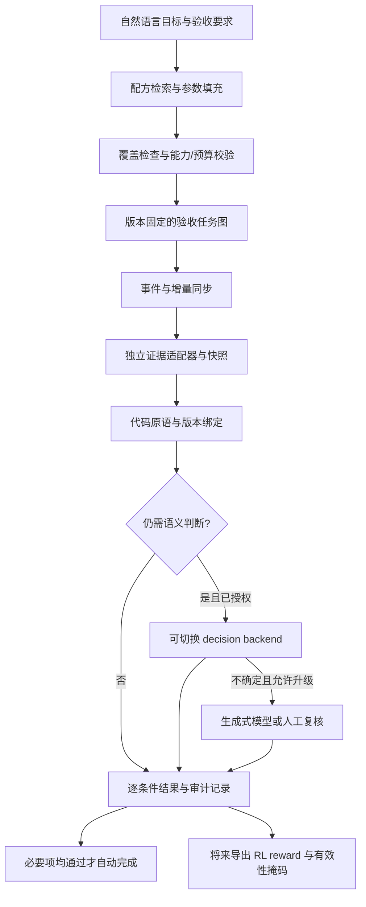

# 从桌面评测到低成本自动验收：Agent Verifier 源码综述

核查日期：2026-10-19。面向 Dayproof 的真实需求：用户或任意 agent 完成电脑任务后，系统独立读取结果，低成本自动验收。本文中的 decision model 特指用户所说的 **Jev 类 typed decision model**，不是“让聊天模型输出 JSON”的别名。

本文是有选择的工程综述，非穷尽性系统综述。重点检查官方文档、固定提交的源码、模型卡、许可和调用路径；没有安装全部框架、下载模型权重或调用模型 API。效果、内存和延迟若来自作者，均不视为本机复现。版本与证据索引见 [research/verifier-review-sources.json](research/verifier-review-sources.json)。前一份[领域地图](verifier-landscape-2026-10-19.md)保留更多外围项目，本篇深入判断机制与缺点。

**需求更新后的产品取舍：** 本文比较保留为技术依据，实施优先级以 [Work Plan 轻量验收策略](work-plan-verification-policy.md) 为准。当前目标是个人每日计划：用户可接受 README 完成声明，也可直接手动确认看电影等任务。不要求默认采用下文所有严格验收与 RL 机制。

## 1. 先回答最关键的问题

**现有系统已经覆盖了我们设想中的很多部件，但不能因此直接替换整个 Dayproof。**

1. “自然语言生成 verifier code，再用于桌面 agent RL”已有直接相关工作。OpenComputer、CUA-Gym、ScaleCUA/VeriGen 都值得借鉴，不能将这个宽泛方向作为首创。
2. “现有框架只有代码或昂贵 LLM judge”不成立：**Prime Intellect Verifiers 当前源码已有 `DecisionJudge`，默认模型就是 `cloudflare/clef`。** 这是实质性的决策接口，不是生成长答案再解析 JSON。[P1]
3. 另一方面，决策模型也不是最近才出现的全部判断技术。零样本分类、NLI、奖励模型、过程评分早已存在；2023 年的过程监督与 2024 年的 RewardBench 是清楚的先例。[H1][H2] Jev 的新价值在于开放任务描述下的类型化接口、概率输出及自动化使用方式；不能据此推断旧 verifier 都没有小型判别模型。
4. **最值得保留的是独立证据运行时，而不是继续扩张一个万能 `decide()`。** 建议复用文件/应用检查原语，加入可切换的决策后端，自己负责验收条件覆盖、证据版本、事件缓存、预算、授权和未知状态。
5. 本次未确认有一个开源成品同时做好“真实个人桌面、多执行者、自然语言编译、跨应用版本绑定、低成本持续验收、原生计划器”。这是调研范围内的缺口，不能等同于已经证明存在论文创新。

## 2. 比较框架之前，先分清四件事

| 层次 | 解决的问题 | 不能代替什么 |
|---|---|---|
| 观察与取证 | 文件/应用/服务器到底有什么状态 | 不能从 agent 自报中证明现实已改变 |
| 验收计划编译 | 用户的每个条件分别用什么方法检查 | 不能因为检查难就悄悄删除条件 |
| 判定 | 代码断言、NLI、decision model、生成式 judge | 模型给分不能证明输入证据完整且可信 |
| 持续运行与奖励 | 何时重查、是否自动完成、如何映射 reward | 一次 benchmark 评分器不等于个人后台验收服务 |

Jev/Clef 主要提供第三层。OSWorld/DocOps 主要提供第一层和部分第三层。Verifiers 提供评测/RL 的组织层。它们解决的问题不同，不能按“谁更通用”简单排一个总榜。

同时分清**编写成本**与**运行成本**：用强模型生成/修复代码一次，不等于每次检查都调用强模型；反过来，一段普通 Python 也可能在内部调用模型、OCR、浏览器或远程服务。

## 3. 桌面与办公框架：实际实现、成本与适用边界

| 项目 | 生成/配置阶段 | 运行时判断路径 | 最适合复用 | 主要限制 |
|---|---|---|---|---|
| OpenComputer | 任务生成、端点扩展、执行及修复 | 应用 JSON 状态 + 代码比较；可选生成式多模态 judge | 参数化应用检查接口 | Linux 沙箱假设；部分解析不完整；自由 `eval`；可选模型费用 |
| OSWorld | 多为已有任务配置和参考产物 | getter + metric，单项或组合 | Office/桌面状态指标目录 | VM/应用依赖，参考答案约束，部分采集会改变状态 |
| DocOps | 预定义办公任务与目标属性 | 文件解析 + Python 断言 | 文档结构、格式、保留属性检查 | 已知目标容易验，新内容质量仍难；解析依赖较重 |
| CUA-Gym | Generator/Discriminator，正反初态测试与过滤 | 代码 reward，可嵌 Sonnet/Qwen 生成式 judge | verifier 生成与质量控制流程 | 模拟环境较多；文本裁剪；失败返回 0；重试成本 |
| ScaleCUA / VeriGen | coding agent 生成、审查、修复 evaluator | 由生成的 evaluator 决定 | 函数目录、领域 skill、动态测试 | 生成耗时与沙箱；不能以审查器模型推断全部运行成本 |
| Prime Verifiers | 定义环境、任务、rubric | 代码/生成式 judge/**决策接口** | 评分协议、计费记录、RL 适配 | 默认评 agent 回复，不是实际桌面；仍需证据适配器 |
| WorkArena | ServiceNow 任务配置 | 应用页面 + 服务端记录 + 字段比较 | 企业业务状态验收 | 实例/权限/会话耦合；等待一致性会增加延迟 |
| OfficeBench | 固定跨应用任务 | 文件、关键词、单元格、日历等代码检查 | 跨应用任务样例、便宜原语 | 关键词≠语义，反条件需存在性前提 |
| Heliox OS | 与自身桌面 agent 集成 | 部分动作独立后置检查；部分只标记 reported | 动作结果与独立观察分开记录 | 未独立验证仍可能总通过，不能当严格任务终局 verifier |

下面的默认模型仅描述固定源码版本，不是价格或最佳模型推荐。各项目数量和论文成绩不直接比较：环境、成功定义、任务难度、人工标注均不同。

### 3.1 OpenComputer：最接近“通用函数 + 模型填参”的底座

它把应用封装为 Python CLI，返回 JSON，再以任务参数比较状态。Writer 里已经有文件存在、段落、标题、表格单元格等接口。仓库甚至包含真实的“会议纪要”任务配置：标题、参会人、行动表及负责人、保存与路径条件。[O1][O2]

这支持用户提出的优化：模型选择现有检查器并填参数，不必每个任务重写完整 Python。

其 `verify_task()` 有两条路径：[O3]

- 普通检查调用 verifier 命令，然后比较键值或执行配置中的 `eval` 表达式。
- `judge: llm` 汇总到另一分支；有轨迹时先用生成模型选相关步骤，再把截图/命令结果交给一次批量 judge。不能简单算作“每条标准一次模型调用”；也不能称整个项目不调用模型。

固定版本的 judge 默认是 `gpt-5.4`，最多取 15 张 judge 截图。smoke loop 用 agent 执行、LLM judge、比较器和修复器检验生成任务。这部分主要是**生成与质量控制成本**，纯代码任务的日常检查不因此强制调用模型。[O4]

发现的限制：

- [本机离线小实验](research/opencomputer-offline-smoke.json)确认 Writer 的 `parse_file_text` 将标题排在正文之后，而且遗漏表格单元格；独立 table API 可以提取。它不是完整文档证据入口。实验仅针对自己构造的最小 ODT，不是整个 LibreOffice 集成测试。
- 某些方法优先读取 live UNO 状态，离线模式又可能自动找文件。个人电脑必须显式绑定指定路径和快照，不能拿当前窗口或目录中另一个文件替代。
- `eval` 接受的表达式比 Dayproof 所需能力更宽。建议复用原语，替换运行器为受限操作及参数 schema。
- `verify_task()` 开头有固定 3 秒等待。可重置 benchmark 的稳定等待不适合原样用于高频个人桌面检查。
- 存在章节或行动表，仍不能证明技术路线正确、资源足够或与会议决定一致。

**结论：优先适配它的端点设计与少量检查函数，不整体引入沙箱训练系统。**

### 3.2 OSWorld：丰富的 getter/metric，不能原样当后台监控器

源码将证据获取与指标比较分开，覆盖文档、表格、幻灯片、浏览器、邮件等。`DesktopEnv.evaluate()` 读取任务指定 getter，比较 expected 或调用单输入 metric，并按 AND/OR 聚合。[S1][S2]

这是良好的分层参考，但其上下文是受控 VM：任务知道初态、文件位置、参考结果和应用版本。真实用户任务缺少这些信息时，必须额外编译验收条件。

容易低效或失真的场景：

- 文档模块包含 OCR/图像/文档等重依赖。“代码检查”不等于启动快、占用少。
- 指定参考文件或精确状态可以拒绝合法的替代实现；这是覆盖不足引发的假阴性，不是模型问题。
- `evaluate()` 会先执行可配置的 `postconfig`。这些步骤在 benchmark 中用于准备证据，但接入个人工作时要检查是否会保存、切换应用或改变状态，避免验收过程替用户完成任务。
- 文件缺失可直接返回 0；这种评分约定不能直接移植到个人任务的 `pending/unknown/error` 或可信 RL reward。

本文核查的是这些确定性路径，不主张仓库每个扩展 metric 永远不调用模型。复用时应逐函数声明能力、依赖和成本。

**结论：把它作为指标与状态采集的参考库，按需提取，不运行完整 VM 作为日常计划器依赖。**

### 3.3 DocOps：原生办公文件与“未破坏什么”检查很有价值

DocOps 仓库发布 210 个 Harbor 办公任务，关注 DOCX/XLSX/PPTX/PDF 中指定修改与原有属性保留。核查的 `verifier_utils.py` 和 Word 样例用文本归一化、必需/禁止内容、正则、段落签名、标题/字体/样式等断言检查结果。[D1][D2]

函数名 `test_semantic_verifier` 不意味着它调用了语义 LLM；读到的样例仍然是确定性测试。

相对“文件里出现某个词”，它更关心：改对了什么、是否产生旧标题/重复项、是否破坏原有格式。对于“更新报告而不要修改既有表格”，这是比单一完成分更好的验收方式。

限制包括：多数测试绑定具体任务；已知标签及结构不等于理解任意方案；公共辅助模块导入了多种办公/PDF 库，做桌面插件应拆成按格式加载；PDF 原生文本可解析，也不代表扫描图或布局关系已被完整理解。

**结论：DOCX/XLSX 等优先借鉴它的原语与 invariant 检查；把确定性结构判断与内容质量判断分开。**

### 3.4 CUA-Gym：生成/审查流程值得学，运行时仍有生成式 judge

其 Generator 与 Discriminator 分离；reward 生成说明要求从原始任务独立设计检查，并验证初态=0、golden=1。提示中建议代码得分至少 60%、LLM 至多 40%。这是生成规范，不能当作运行器强制执行的保证。[C1]

实际 `utils/reward_judge.py`：[C2]

- 文本 helper 默认 `claude-sonnet-4-5-20250929`，视觉 helper 默认 `qwen-vl-max`。
- 文本生成 score/reason，再解析、容错和裁剪分值；它是生成式 judge，不是 Jev 式决策头。
- 文本 `state_excerpt[:6000]` 可能截掉末尾关键条件；默认输出上限 300 tokens，视觉/视频 helper 分别有不同上限。
- `_MAX_RETRIES=5` 实际循环可尝试 **6 次**。缺 key 或全部失败返回 `0.0`，会把基础设施错误混同为任务未完成。

离线过滤脚本默认用 `gpt-4o` 做 3 次投票，这是生成任务质量控制开销，不能加到所有日常 reward 的必需成本上。[C3]

对个人后台尤其要改：代码/模型子检查必须各自返回有效状态；不能把“模型限流了”显示成“文档不合格”。加权 60/40 也不适合表示“全部完成”：必要条件应逐项通过，不能靠别的项高分抵消“发错领导”。

**结论：借鉴独立生成、初态/正例/负例检查；不照搬 helper 的错误处理、截断和评分聚合。**

### 3.5 ScaleCUA / VeriGen：强模型主要出现在 evaluator 编写与修复

`VeriGen` 提供已有检查接口的 skill、生成 evaluator、执行校验及修复流程。核查的 `llm_judge.py` 默认 `sonnet`，检查 evaluator 代码逻辑；`llm_fix.py` 默认 `opus` 做修复。[V1][V2]

因此，“它用了 Sonnet/Opus，所以每次验收都很贵”是错误推断。这些调用发生在编写/审查阶段；最终成本取决于生成出来的 evaluator 是否只用代码、又调用了什么接口。

缺点是新任务生成仍可能需要较长 coding-agent 与沙箱流程；正例/空操作测试不足以证明所有负例都被拒绝；代码扩展跨系统需要依赖适配。根许可在此次读取版本中未确认，公开可读不等于可直接合入开源产品。

**结论：借鉴能力目录及动态验证，把慢速生成留给新插件扩展；常见任务走现成配方填参。**

### 3.6 Prime Intellect Verifiers：已明确支持决策模型，但不会自动看懂桌面

这是本次相对初稿的重要补充。固定版本中存在：

```python
class DecisionJudgeConfig(JudgeConfig):
    model = "cloudflare/clef"
    base_url = "https://api.pinference.ai/api/v1/evaluations"
    levels = ["Incorrect", "Correct"]
    view = "last_reply"
```

`DecisionJudge.evaluate()` POST `state + questions.grade(type=score)`，把返回等级期望归一化到 [0,1]，并记录输入量和费用，连解析失败的已计费调用也写 trace。[P1]

这证明主流开源评测基础设施已开始纳入 Jev 类评分。它还有生成式 Reference/Rubric judge，不能把整个框架称为“只用决策模型”。[P2]

但默认 `score()` 提交的是**任务问题与 agent 最后回复**，可选附参考答案。没有自动读取文件、Telegram 服务器或用户应用状态。“我已发送”回复即使被打高分，也不能证明真实发送。我们必须把独立采集的证据送入后端，不能直接套默认配置。

还有两个边界：默认是远程服务，不是本地免费；两个等级时可解释成模型估计的正确概率，但这不是经过我们任务域校准的错误完成率保证。

其独立 grading sandbox、仅转移声明产物与私有测试设计适合以后 RL 适配。[P3]

**结论：保留为 RL/评分接口参考；决策模型支持本身已经不是我们的差异化。**

### 3.7 WorkArena / OfficeBench：业务状态比截图强，但每条断言仍有边界

WorkArena 的 ServiceNow 表单 `validate()` 先确认提交记录 ID，再通过 Table API 取服务端记录、比较字段，并对部分越界修改做检查。查询有最多 20 次等待记录的重试配置，源码说明约等待 10 秒。[W1]

优点是“按钮点了”与“记录真的创建了”分开；缺点是依赖实例、会话与特定字段，并非天然覆盖所有未要求的修改。它适合作为 Telegram 交付验证的设计参照：用真实服务器对象，而不是让模型读发送意图。

OfficeBench 的 `utils/evaluate.py` 包含关键词、文件、单元格、日历等便宜检查。[B1] 本次用固定源码的四个 AST 提取函数，在临时 TXT 上执行了两个对照：

1. 单独调用 `evaluate_not_contain()`，文件不存在也返回 True，因为实现是 `not evaluate_contain(...)`。
2. `There is no implementation plan and no acceptance test.` 会通过要求 `implementation plan` 与 `acceptance test` 的关键词检查。

复现：[脚本](../scripts/research/smoke_officebench.py)、[结果](research/officebench-function-smoke.json)。这仅证明局部函数语义，不证明整个 benchmark 可被这些样例攻破；上层组合任务可能另外检查文件存在。第二项也不一定是函数 bug：函数本就只承诺字面包含，错误在于将它当语义验收。

**结论：复用代码前，明确它证明的命题及前置条件。`不存在禁止内容` 应要求 `成功读到指定文件`，不能把观察失败取反为成功。**

### 3.8 Heliox OS：动作级后置检查不等于用户目标验收

其 verifier 对部分文件写入/复制、进程/服务等动作进行独立检查，并区分 `VERIFIED` 与 `REPORTED — no independent postcondition`。但未知动作分支返回 `(True, ..., False)`，因此聚合通过不一定意味着所有动作都被独立观察。[X1]

这比隐藏证据缺口更透明，但 Dayproof 必须把最后那个 False 映射为未验证。文件写入与 agent 请求内容一致，也仍不能证明请求内容满足用户最终目标。

项目的本地模型与类型化决策/风险门控不应直接等同于通用完成判定；需要逐条检查模型实际承担的职责。

**结论：借鉴独立观察标记，不复用其“reported 也可能总通过”的完成含义。**

## 4. Jev 类决策模型：具体有哪些可用选项

以下表格把模型与桌面框架分开。**接口兼容不代表相同训练、相同校准或相同能力。** 商业/开源许可也要同时看代码与权重。

| 候选 | 核查到的实现 | 本地部署与成本 | 对 Dayproof 的关键限制 |
|---|---|---|---|
| TypeSafe Jev | 官方 typed choice/score/noul，概率与 confidence；闭源托管服务 | 本次未确认公开本地权重；官方列输入计费 | 不是电脑状态采集器；中文需验证；复杂推理/大状态仍有失败边界 |
| Cloudflare Clef / Clef-Flash | 27B / 9B 多模态 backbone + joint schema head，多问题联合评分 | 权重与发布代码 Apache-2.0；可自部署，也有付费托管 | 自部署仍需内存/算力；发布样例偏 GPU，不等于已支持本机轻量常驻 |
| OpenDecider | nano 用约 400M encoder + marker/MLP；small 用 4B + LoRA 读选项 logits | 代码/核查的 nano 权重 Apache-2.0；支持本地 CPU/MPS/CUDA | nano 输入 2,048 tokens、英文评测；不能直接验收中文长纪要 |
| OpenDecision | 默认 ModernBERT 零样本 NLI；文档检索、支持/矛盾/未知、规则组合 | Apache-2.0 代码；模型许可另核查；本地 CPU/MPS/CUDA | preview，概率未校准；多候选需成对评分；检索遗漏导致证据不完整 |
| OpenJev `openjev/openjev` | 调优语言模型的首个输出位置读取选项分数，固定校准参数 | 可本地；模型卡 BF16约54GB，MLX4约15GB；权重 CC-BY-NC-4.0 | 非商业限制；一个问题一次前向，非全 schema 一次；Mac 量化版卡称仅文本 |

### 4.1 官方 Jev：便宜，但不应被描述成免费或永不出错

以 TypeSafe 官方站点和 `docs.typesafe.ai` 为依据，不将同名社区页面当作官方文档。官方当前模型表列 `jev-1.14.0` / `jev-1.13.0`，输入价格 **$0.042 / 百万 tokens**，输出免费；默认上下文为每请求 64k、每问题 32k，并说明多问题共享 state。[J1]

这比“所有远程 judge 都很贵”的印象便宜很多。我们仍要用实际账单核对输入统计、问题规模和重试。官方未在本次检查材料中提供可下载的 Jev 本地权重，不能叫本地开源模型。

官方 confidence 文档明确给出了由概率分布计算 confidence 的公式。它不等于聊天模型随口生成的 `confidence: 0.99`，但也不能把 `confidence=0.95` 直接理解为“我们的中文办公任务保证 95% 正确”。[J2]

其 1.13 jaggedness 文档公开列出：计数/数学/日期比较、复杂间接推理、长状态中的干扰、恶意内容、选项顺序等问题。[J3] 这是旧版本已知限制，不断言 1.14 每项原样存在；但没有证据时，也不能假设新版本已解决。官方当前模型页还说明英文最强、其他语言包括 CJK 表现不同。[J1]

**适合：** 对清晰证据作窄判断，例如“这个段落是否给出具体实施步骤”。金额、时间、数量、文件版本、消息接收人仍交给代码。

### 4.2 Clef：已经有真正公开的联合决策头

模型卡与 `joint_schema_model.py` 对得上：backbone 产生 hidden states，joint head 读取状态和 schema，为所有问题/选项输出 logits，再逐问题 softmax；不是循环生成一串解释再解析。[DMC1][DMC2]

这与 OpenJev 的“每问题一次首 token 评分”有实质差别。对于一篇纪要的多条 rubric，**共享证据预处理、一次送入多条窄问题**是值得测的效率路线。联合评分也不使多个问题的错误彼此独立，不能简单把概率相乘当作父任务可信度。

核查的两种权重均 Apache-2.0，Clef 27B，Flash 9B。[DMC4] 官方 Cloudflare 托管 Clef 页面当前列 **$0.24 / 百万输入 tokens**、不收输出 token 费；这不是 Prime 转售接口的已核实价格，也不是 Flash 价格。[DMC3]

本地代码 `encode_record` 默认上限 **16,384 tokens**，会裁剪 state；托管页面的上下文窗口列 65,536，二者不是同一运行配置。不能看到模型支持长上下文，就假定自部署示例没有截断。

**适合：** 作为较强、多条件/多模态的对照后端。对普通 Mac 的延迟、占用、量化可用性本次未测，暂不推荐直接设为默认常驻。

### 4.3 OpenDecider：最值得低资源试验，但中文是明确待验项

核查 nano 的源码：每个选项放一个 marker，encoder 隐藏状态经小 MLP 输出 logits，各问题在 padded batch 中处理。模型卡称约 400M、下载约 0.8GB；作者报告在 M4 Max 的短请求约 18ms、在 16GB M4 Mac mini 约 28ms、约 2GiB 使用量，均未在本机复现。[DMO1][DMO2]

它比把 15GB+ 模型常驻计划器更接近轻量目标，但有两个硬限制：

- `max_len=2048`，为保留选项会先截断 state，并可报告 `truncated`。不能把中文纪要整篇塞入后忽略标记。
- 模型卡明确 **English only so far; no multilingual evaluation**。我们的中文任务必须单独测，翻译也会带来费用、延迟及新错误，不能默认自动翻译就解决。

small 用 4B 模型及 LoRA，在限定选项规模时读首位置 logits；更大的候选集合有另一评分路径。不能把 nano 的最小内存、吞吐和 small 的泛化表现合并成一个产品承诺。

作者比较表里一些模型在 typed-decisions 训练集上微调，Jev 则是 zero-shot，作者也标明不完全同条件。因此不能用那个总分宣称“已全面超过 Jev”，更不能推导出它能可靠识别发错附件。

**建议优先做小规模中文、否定句、缺证据、长文截断测试，合格后才用于自动完成；否则只作候选筛选或辅助 review。**

### 4.4 OpenDecision：更接近可解释证据关系，但不是免费的万能理解器

默认使用 `MoritzLaurer/ModernBERT-large-zeroshot-v2.0` 的 zero-shot-classification，并提供 relation/evidence 与文档拆分检索。[DMN1][DMN2]

有用的部分是：文档可以返回选取的片段；对 proposition 区分 supports / contradicts / unknown，组合结果可标记 conflicted。这比只问“完成了吗”更接近验收需求。

但源码也说明了成本与覆盖边界：

- NLI 需要状态与候选命题成对处理；批处理减少墙钟时间，不会使任意多候选没有计算量。
- 文档默认分块 384 tokens，然后挑 top-k。检索到一段支持文本，不能证明全文没有矛盾或所有必需项都出现。
- 直接 NLI 路径也有 tokenizer 截断与最多 8,192 的限制；不同 primitive 不应假设相同有效上下文。
- 仓库明确是 developer preview，分数未校准；图像分支用 SigLIP2，README 公开提及计数、否定描述的错误。[DMN3] 图文相似度不等于精确的桌面终局验收。

**结论：它的 evidence/relation/rule 结构值得借鉴；模型准确率、中文及跨段推理必须作为待测假设。**

### 4.5 OpenJev：能本地，但许可、体积、每问题计算都要算

这里特指 HF `openjev/openjev`，模型卡明确它与 TypeSafe 无隶属关系；GitHub 还有其他同名项目，不能混用其说明。[DMJ1]

核查 helper 的模型请求与模型卡一致：给选项分配标签，从首输出位置读取 logits；最多 52 个选项一轮，更多选项要多阶段；多个问题分别进行前向。它确实减少长文本生成与 JSON 解析开销，但不消除长输入 prefill。

作者报告 H100 上短文本约 80ms；15.1k 输入初次读取约 1.76 秒，缓存后约 257ms。不能把 H100 数字当作普通 Mac 延迟。Apple 量化版模型卡列约 15/27GB、文本输入；权重 **CC-BY-NC-4.0**，helper/serve 代码 Apache-2.0。研究试验与未来开源产品/商业分发的许可决策应分开。

尤其值得引用的是作者自己的提醒：**把 DONE 当模型意见，再从成功提示、保存记录或状态变化确认完成。**

### 4.6 不应忽略的历史与评测工作

- **STEVE（2025）**：论文用 GPT-4o 看动作前后截图，为步骤打二元标签，再做 KTO。它是生成式模型产出训练标签的直接先例；步骤是否合理不等于终局任务已完成。[H3]
- **AgentRewardBench**：针对自动评估的专门研究；论文分析规则低估成功、生成 judge 被 agent 推理误导、漏掉指令细节及 grounding mismatch。应借鉴它的人工标签与错误分类，不照搬某个“最强 judge”。[H4]
- **过程/结果奖励模型**：早于“Jev 类 decision model”称呼。它们证明非长文本生成的评分不是空白方向，但任务域从数学/回答偏好迁移到真实桌面仍需研究。[H1][H2]

本次没有穷尽 Laya、Microsoft Decision 等全部新模型；本文已深入核查的候选足以说明“没有开源决策模型/框架不支持它们”都不是成立的前提。

## 5. 为什么仍没有“几乎所有电脑任务都完备”的自动验收

根本障碍经常不在模型智能，而在**观察不到足够事实**。

| 用户条件 | 可强验证的证据 | 仅靠模型/截图容易错在哪里 |
|---|---|---|
| 完成指定会议纪要 | 指定文件快照、结构、内容与原始记录 | 文件名相似、旧版本、表格漏提取、用标题占位 |
| 形成可落地技术方案 | 明确 rubric、会议目标、约束与实施/验收描述 | “写得具体”不等于现实可行；没有业务资料就无法证明 |
| 发给指定领导 | 出站服务器记录、稳定收件人 ID、附件版本关联 | 输入框草稿、同名联系人、发了旧文件、截图显示成功但未持久化 |
| 领导批准 | 对应版本的明确审批事件 | “已发送”“已读”都不是批准 |
| 改用官方 Claude 入口而非第三方 API | 明确使用的是哪个 Claude 产品；官方账号/入口、实际会话与连接配置证据 | 删除一个 API 环境变量不能证明全部调用改走官方，也不能证明当前账户有权限 |

最后一个任务还要区分 Claude 网页/桌面免费账户与 Claude Code 的可用权限，不能让 verifier 把“能打开官网”当成“免费使用 Claude Code 已实现”。本文不重新核查 Anthropic 当前订阅政策；创建该任务的验收标准前应以官方政策明确产品范围。

因此，合理的“完备”定义是：**每个验收条件都有明确的证据与检查方法，观察不到的条件明确 unknown。** 不是所有条件都一定可以自动通过或判假。

### 单一分数不足以自动打勾

建议使用下列结果协议，后端不同也保持语义一致：

```text
verdict: pass | fail | unknown
execution: ok | error | denied | budget_exhausted
criterion_id, evidence_id, source_version, observed_at
model_id/version, probabilities, calibration_version (若适用)
coverage: complete | partial
```

`fail` 表示在足够证据下明确不满足；尚未生成文件可以继续 pending，不能把“尚未完成”当作永久失败。限流、解析失败、权限缺失与预算耗尽不得转换成可信 0/1 任务结论。

概率、confidence、引用、覆盖度分别记录。引用存在只证明模型引用了输入；概率集中只证明模型偏向某一选项；只有各必要条件、证据及版本关系都满足才允许父任务完成。

## 6. 成本优化：最大收益通常来自少检查，而不只是换模型

一个粗略的端到端延迟分解是：

```text
取证/同步 + 文件解析/OCR + 检索与分块 + 模型输入处理/评分
          +（生成式后端才有的输出解码）+ 网络排队/重试 + 结果写回
```

decision model 主要降低生成与解析开销；它不自动缩短服务端同步、Office 启动、长文读取或多问题/多块计算。联合 schema head、prefix cache 和 batch 的收益也要分别测，吞吐不能冒充单次交互延迟。

示例（纯预算计算，不是实测）：8 小时内每 5 分钟检查约 96 次，若每次实际计费 2,000 输入 tokens：

- 按当前官方 Jev 单价，约 **$0.0081**；按 Cloudflare Clef 页面单价，约 **$0.0461**。
- 若只有 3 个稳定内容版本，并且每版本一次成功语义评估，相应约为 **$0.00025 / $0.00144**。

这些数字未计长文/图片扩张、额外问题 token、重试、规划及服务商差异，不能作为预算保证。它们说明两件事：Jev 类托管决策可能已经很便宜；即使便宜，事件缓存仍可减少延迟、能耗与后台请求。

推荐顺序：

1. 文件/消息事件与增量游标先触发，去抖，等待稳定快照；低频补偿扫描处理丢事件。
2. 代码门控：文件缺失、格式不可读、硬条件未满足时不启动语义模型。
3. 缓存按输入哈希、任务/rubric、提取器、插件和模型版本共同失效；未满足但有效的判断也可复用。
4. 把可判定条件留在代码：ID、版本、日期/数量计算、状态码不占语义预算。
5. 对同一证据批量提交多条清晰问题；如果分块或多后端，所有子调用计入预算，记录覆盖范围。
6. 无法可靠判定时 unknown/review；在已授权策略内才升级生成式 LLM，禁止自动换付费后端。

**OpenRouter 免费模型只是可选生成式后端。** 免费不等于决策模型，也不消除输入处理、限流或可用性问题。此综述未核实某个免费 endpoint 的长期额度，因此不承诺永远零 API 费用。

### 授权必须区分编译与循环运行

用户已明确要求：verifier 内部还要调用模型时提醒并授权。应在激活含模型节点的计划时展示后端、触发条件、证据范围、次数/输入/费用预算。一次按范围授权即可，不必每轮弹窗。本地也应说明资源消耗；切到远程、更大数据范围或增加预算时需要更新授权。

这是产品设计建议，本文没有为当前 Dayproof 实现这些控制，也没有调用任何本地/远程模型检查用户任务。

## 7. 如何集成：保留产品，修改验收核心，选择性复用上游



### 保留什么

- 原生悬浮计划器、菜单栏、日任务/deadline、SQLite 与 agent 接入入口。现成 benchmark 不提供我们想要的完整产品体验。
- 代码规则的快速路径；将历史检查记录发展为可追溯证据记录。
- 外部 solver 与 verifier 的职责边界：Codex/Claude 等可以创建计划或执行工作；验收器按用户约定读取依据。用户可以明确选择 README/状态文件中的声明作为轻量依据，此时应显示“按声明验收”，不能冒充真实运行验证。严格任务仍不能只凭 agent 自报批准。

### 修改什么

当前 `src/server/decision.ts` 实际是文件/字面内容/JSON 检查与 **Ollama 生成式 JSON judge**。`autoComplete + confidence >= .95 + 可定位 quote` 是已有门槛，**不是 Jev，也不是校准后的正确率保证**。字面 quote 可以支持结果审计，但不能单独证明所有条件。

因此建议：

1. 把单项 rule 扩成条件 DAG；将 `inspect`、`predicate`、`semantic`、`delivery-binding` 分离。
2. 决策后端协议抽象成 typed questions/probabilities，允许接 OpenDecider/OpenDecision/Clef/Jev，但不要假设所有后端语义和校准兼容。
3. 用统一的 unknown/error/coverage 协议替代只依赖 boolean/confidence 的自动完成。
4. 加内容版本缓存、完成写回前的版本复核、持久化授权与次数预算；运行器强制执行，不能靠模型写出的 JSON 自律。
5. `SKILL.md` 描述何时选哪个能力、填哪些参数；插件提供代码、schema、许可、依赖与测试。注册后运行时直接调用代码，不每次启动 coding agent。
6. 新代码只在现成原语不足时生成，经过审查、正反例与资源/权限边界后注册；插件不得自行隐藏模型/网络调用。

任务创建也可分成快慢两条路：先检索少量候选配方，用规则抽取显式路径/日期/ID，再让模型选择能力、填槽和补全 rubric；只有无法表达的长尾需求才启动 coding agent。Jev 类模型可以承担候选选择或窄分类，**不能代替生成模型编写新插件代码**。复杂自然语言拆解仍可一次调用本地/已配置的免费生成模型，输出受限 JSON，再由代码检查参数、依赖和条件覆盖；不需要每次定时验收重复规划。

这降低的是常见任务对 coding 能力的要求，不是保证任意小模型都能理解所有用户目标。关键参数缺失时要补问，困难条件要保留 unknown，不能为让编译成功而自动删掉。

### 上游复用优先级

| 优先级 | 动作 | 通过条件 |
|---|---|---|
| 第一批 | 包装少量 OpenComputer/DocOps 原语；选择 OSWorld 指标参考 | 固定输入快照、输出协议、许可及负例审查通过 |
| 第一批 | OpenDecider-nano 与 OpenDecision 做本地小样本对照 | 中文/否定/未知/截断表现可接受，不能只看英文公开榜 |
| 第二批 | 增加 Clef-Flash 或 Jev 对照，配置明确本地/远程策略 | 实测端到端成本、中文办公判定质量与错误完成率 |
| 第二批 | 只读 Telegram 交付适配器 | 可见真实出站记录、稳定接收人及附件版本绑定 |
| 后续 | Prime Verifiers RL 适配；借鉴 CUA-Gym/VeriGen 插件生成测试 | verifier 质量先通过独立评测，有可重置测试环境 |

不是把上游目录复制进仓库就完成集成。OpenComputer/OSWorld/DocOps/CUA-Gym 的根代码许可核查为 Apache-2.0，Prime/Heliox 为 MIT；附带 skills、数据与模型分别核查。ScaleCUA 未确认根许可，OpenJev 权重有 NC 限制，不列为可无条件捆绑的默认依赖。

### 用会议纪要例子具体说明

验收计划先拆两个子任务，但保留“同一份已验收文件”的关系：

**A. 完成纪要与方案。** 代码读取指定 DOCX 快照 H，解析正文、表格和位置；检查约定结构。对“有具体步骤”“有负责人和验收方法”“符合会议目标”分别给窄语义问题。若没有会议原始记录，不能证明纪要忠实性；若没有资源/技术约束，不能宣称现实可行性已被证明。

**B. 发送该版本给领导。** 代码通过有权限的只读连接器查出站服务器记录，绑定发送账号、接收人 ID、时间和附件内容 H。不能用文件名相同代替内容相同，也不必让模型循环读聊天历史。

Telegram Bot API 不天然拥有个人账号全部历史。若连接器读不到所需消息或附件字节，就保留 unknown；不设计一个实际上无法取证的“万能检查 Telegram”函数。发送本身仍由用户或执行 agent 完成，验收器负责观察。

## 8. 论文与 RL：仍可研究什么，哪些已经不能当首创

不能独立作为新颖性主张的方向：LLM 写 verifier、代码 reward、任务拆分、复用 skill、用 verifier 训练桌面 agent、typed decision judge。这些已经分别或组合出现。

值得检验的更窄假设是：

> 在真实办公组合任务中，将自然语言验收条件编译为可复用原语与窄决策问题，在控制错误自动完成率的前提下，能否比逐任务写代码和每次生成式 judge，取得更低配置成本、更少推理与更高自动验收覆盖率？

实验必须包含至少五类基线：人工配置代码、逐任务 LLM 生成代码、每次生成式 judge、代码 + decision model、带模板/缓存/证据绑定的完整方案。模型/提示词编写成本和运行成本分开报；缓存与联合 schema 评分分别消融。

建议先做 60–100 个任务的小试验：文档生成/修改、表格处理、测试账号下的文档交付；这只是试验规模建议，不是统计功效保证。每任务构造正确结果、漏条件、否定句/占位、旧版本、错误接收人/附件、连接器失败、恶意诱导等变体。由独立人工按原始要求标注，并按任务族/应用/文档来源留出，避免只换文件名。

关键指标：

- **错误打勾占自动打勾的比例**，以及 **所有未完成样例中被误打勾的比例**，分别报告，避免混为一谈。
- 在同一错误约束下的自动覆盖率、误拒绝率、unknown 比例及人工工作量。
- 编译失败率、插件复用率、配置时间、取证与模型端到端延迟、本地内存/能耗、输入量、调用数与实际 API 费用。
- 中文、长文、分块覆盖、跨版本绑定和模型升级后的校准稳定性。

对高置信自动完成的阈值，应在留出集上选择并报告置信区间；不能因为模型在通用分类上 80% 准确，就允许它自动打勾。多模型投票若证据缺失或错误相关，也不能当作独立证明。

RL 还要求冻结 reward、隐藏私有测试、隔离 solver 的修改权限、可重置初态，并审查 reward hacking。unknown/error 不是可信失败标签，应输出有效性掩码；动作进展分可用于诊断，不能把局部高分误认为终局成功。真实老板账号不应成为反复重置和发送的训练环境。

**当前建议：继续保留自己的产品与组合运行时，但停止把“造一个新 judge”当作核心目标。先证明证据、复用与预算编排比现成方案更可靠、更省，再决定投稿方向。** 尚未证明这一具体组合有未发表的新颖性。

## 9. 第一方来源与可复现范围

链接尽量固定到本次核查提交。动态官方价格页与模型页按 2026-10-19 快照描述，未来可能变化。除了两个局部函数实验，本文不声称独立复现论文效果。没有修改 Dayproof 业务代码、现有任务或连接个人通信账号。

[O1]: https://github.com/echo0715/OpenComputer/blob/76c5ec32221045a68c4ca47a799e0abc4b303d6a/verifiers/libreoffice_writer/libreoffice_writer.py
[O2]: https://github.com/echo0715/OpenComputer/blob/76c5ec32221045a68c4ca47a799e0abc4b303d6a/task_generator/tasks/libreoffice_writer_meeting_minutes/task.json
[O3]: https://github.com/echo0715/OpenComputer/blob/76c5ec32221045a68c4ca47a799e0abc4b303d6a/evaluation/runtime/verification.py
[O4]: https://github.com/echo0715/OpenComputer/tree/76c5ec32221045a68c4ca47a799e0abc4b303d6a/smoke
[S1]: https://github.com/xlang-ai/OSWorld/tree/b138d348256078fa634fc3b73567a7337c793e6b/desktop_env/evaluators
[S2]: https://github.com/xlang-ai/OSWorld/blob/b138d348256078fa634fc3b73567a7337c793e6b/desktop_env/desktop_env.py
[D1]: https://github.com/icip-cas/DocOps/blob/ccf7a751bc5c8a69c1cdd0400125d53455b33be3/tasks/atomic__word_001_engineering_report_toc_hierarchy_seed/tests/verifier_utils.py
[D2]: https://github.com/icip-cas/DocOps/blob/ccf7a751bc5c8a69c1cdd0400125d53455b33be3/tasks/atomic__word_001_engineering_report_toc_hierarchy_seed/tests/test_outputs.py
[C1]: https://github.com/xlang-ai/CUA-Gym/blob/1e50b797200f8afd6f11ca8e3ee04412de97b0f2/.claude/agents/reward-gen.md
[C2]: https://github.com/xlang-ai/CUA-Gym/blob/1e50b797200f8afd6f11ca8e3ee04412de97b0f2/utils/reward_judge.py
[C3]: https://github.com/xlang-ai/CUA-Gym/blob/1e50b797200f8afd6f11ca8e3ee04412de97b0f2/filter/majority_vote_filter.py
[V1]: https://github.com/THUDM/SCALE-CUA/blob/3929e2fe364623153f2caa94ead71dc1aea50fb0/VeriGen/src/agent/osworld/llm_judge.py
[V2]: https://github.com/THUDM/SCALE-CUA/blob/3929e2fe364623153f2caa94ead71dc1aea50fb0/VeriGen/src/agent/osworld/llm_fix.py
[P1]: https://github.com/PrimeIntellect-ai/verifiers/blob/266c21963d8368d2e9faaf79d61046daad018c9f/verifiers/v1/judges/decision.py
[P2]: https://github.com/PrimeIntellect-ai/verifiers/blob/266c21963d8368d2e9faaf79d61046daad018c9f/verifiers/v1/judges/rubric.py
[P3]: https://github.com/PrimeIntellect-ai/verifiers/blob/266c21963d8368d2e9faaf79d61046daad018c9f/docs/building-environments.md
[W1]: https://github.com/ServiceNow/WorkArena/blob/e885130962f61fb64ac305497996a46cfc7d18f0/src/browsergym/workarena/tasks/form.py
[B1]: https://github.com/zlwang-cs/OfficeBench/blob/b978b808667c32b52ce19a67ce1def1de9ae02b7/utils/evaluate.py
[X1]: https://github.com/VyomKulshrestha/Heliox-OS/blob/a2f72421566d0ebd14e8f96a394011dfc4372547/daemon/pilot/agents/verifier.py
[J1]: https://docs.typesafe.ai/models
[J2]: https://docs.typesafe.ai/confidence
[J3]: https://docs.typesafe.ai/model-jaggedness/jev-1.13
[DMC1]: https://huggingface.co/Cloudflare/clef/blob/0b331204bb13fbd2ca93a64df1956f5b55478ce5/README.md
[DMC2]: https://huggingface.co/Cloudflare/clef/blob/0b331204bb13fbd2ca93a64df1956f5b55478ce5/joint_schema_model.py
[DMC3]: https://developers.cloudflare.com/workers-ai/models/clef/
[DMC4]: https://huggingface.co/Cloudflare/clef-flash/blob/8b2e5fd17c09fd49bc2880b805d5323ec7ff4ff3/README.md
[DMO1]: https://github.com/manjunathshiva/opendecider/blob/7873aa45dbed68ba75f419bf21d0dfd1f09ded5d/opendecider/nano.py
[DMO2]: https://huggingface.co/manjunathshiva/opendecider-nano/blob/1e1f0a7322e446c5ae9bbe840df11680f18a752a/README.md
[DMN1]: https://github.com/deepanwadhwa/OpenDecision/blob/cbd0b50db42bba6975f342de1789fb3c8f2dc670/src/opendecision/engine.py
[DMN2]: https://github.com/deepanwadhwa/OpenDecision/blob/cbd0b50db42bba6975f342de1789fb3c8f2dc670/src/opendecision/documents.py
[DMN3]: https://github.com/deepanwadhwa/OpenDecision/blob/cbd0b50db42bba6975f342de1789fb3c8f2dc670/README.md
[DMJ1]: https://huggingface.co/openjev/openjev/blob/b4a89f5884f3482a5e894b2e7ff01db8ea033726/README.md
[H1]: https://arxiv.org/abs/2305.20050
[H2]: https://arxiv.org/abs/2403.13787
[H3]: https://arxiv.org/abs/2503.12532
[H4]: https://arxiv.org/abs/2504.08942

核心来源直达：[OpenComputer][O3] · [OSWorld][S2] · [DocOps][D2] · [CUA-Gym][C2] · [VeriGen][V1] · [Prime DecisionJudge][P1] · [Jev 官方模型页][J1] · [Clef 模型与代码][DMC1] · [OpenDecider 模型卡][DMO2] · [OpenDecision][DMN1] · [OpenJev][DMJ1]。
