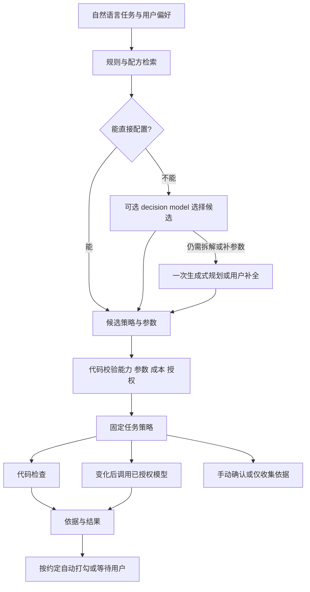

# Work Plan：以可用性和成本为先的验收策略

状态：2026-10-19 设计修订。**最新约束覆盖本文模型路线：后台验收仅用代码，无法判断时由用户确认。** 已实现三类代码检查与旧模型规则停用，详见 [六类任务实例](verification-examples.md)。本文其他 decision model 路由、缓存/预算等保留为未实现的备选设计；[源码综述](verifier-review-2026-10-19.md) 提供上游比较。

## 1. 产品目标

帮助用户少点几次完成按钮，而不是证明每个现实目标都被严格实现。任务首先约定“接受什么作为完成依据”，再选择可运行、成本可接受的检查方式。

用户愿意接受 README 的完成声明，就检查声明；用户要求实际功能可用，才检查测试或运行结果。看电影、休息、线下交流等任务，在没有用户主动配置的证据渠道时默认手动确认。人工路径是正常产品能力，不是验收失败。

系统不能为了省钱私自降低已约定的标准。允许用户选择轻量依据，不代表把任意 agent 的一句“完成了”默认为全部任务的验收依据。已有任务若采用严格标准，保留该标准；新策略不自动改写它。

## 2. 三个独立问题

1. **接受什么依据？** README 声明、产物存在、结构合格、内容符合、运行检查或用户确认。
2. **谁负责判断？** 代码、decision model、生成式模型或用户。
3. **什么时候判断？** 创建时规划一次、证据变化时检查、用户主动触发，或暂停自动检查。

这三个问题不能合成一个“置信度分数”。同样读取 README，可以用代码检查固定复选框，也可以让 decision model 判断一句话是否明确声称完成；两者都只代表声明验收。

## 3. 用户可见模式

| 模式 | 行为 | 典型任务 |
|---|---|---|
| 手动确认 | 不启动后台验收，用户点击完成 | 看电影、运动、思考、线下交流 |
| 自动轻量 | 执行已配置的代码检查，通过后打勾 | 文件存在、README 复选框、JSON 状态 |
| 自动语义 | 先代码取证，变化后按授权调用 decision model | 判断段落是否明确说明某项功能已完成 |
| 仅收集依据 | 记录检查结果，最终由用户确认 | 模型尚未验证、歧义较大、用户想保留控制 |

生成式模型是可选扩展能力：可以创建时填参数，也可以在单独授权后做一次复杂检查。它不作为默认后台模式。关闭自动检查后，手动完成入口仍保留。

手动任务可由路由器直接推荐，不必每次追问。用户随时可以选择或修改验收方式；修改影响既有自动完成依据时需使旧判断失效。

## 4. 路由架构



**路由主要发生在任务创建或修改时，不在每次轮询时重新做。** 路径缺失、权限丢失或插件不可用时，用代码转为暂停/待配置；只有任务、能力或用户偏好变化，才考虑重新规划。

路由输入包括任务说明、验收条目、用户指定的依据强度、现有证据渠道、插件能力、资源与模型预算。候选策略必须带 `manual`，可以带 `observe_only`；模型只能从当前已安装且策略允许的能力中选择。

决策模型适合选择有限候选及回答窄问题，不承担任意代码生成。路径、截止时间等显式字段优先用代码处理；复杂自然语言拆解才需要一次生成式规划。纯手动或明确代码模板无需先调用任何模型。

选择目标是满足用户约定下的最低总负担：API 费用、本机资源、延迟、配置步骤和错误打勾。小型模型不保证总比一次生成式调用快，具体后端需在中文任务上测量。

## 5. 项目阶段开发：按声明验收的完整例子

任务：“今天完成登录模块，读取 `/project/README.md`；其中明确标记登录功能已完成就算完成。”

优先配方：指定 README 的 `功能进度` 节中有唯一标识的条目 `- [x] 登录模块`，代码解析该节与复选框，通过后显示：

> 已完成 · 依据：README 的“登录模块”已勾选。按项目声明验收。

如果项目用自然语言说明进展，则先读指定章节，再让已授权的 decision backend 判断“该章节是否明确声称登录功能已完成”，选项为 `明确完成 / 尚未完成 / 无法判断`。保留片段及文件版本，无法判断时待确认。模型处理范围不足时不能默默截断后声称已检查完整。

`登录模块` 单个关键词、`计划完成登录模块` 或其他功能的 `[x]` 都不足以通过。明确规定结构时无需模型；没有结构时也不必强迫用户为计划软件改写项目 README。

创建任务前已存在的完成声明是否可接受，属于任务约定：默认允许当前状态满足目标；若任务强调“今天新增完成”，则需要基线版本或相应变更依据。仅凭文件修改时间不能证明功能今天完成。

此任务不启动构建、测试或操作界面。只有用户把“运行测试通过”加入标准时，才推荐更强配方。外部 agent 可以更新 README，验收器独立读取该文件；显示其为声明依据，不显示为实际运行验证。

## 6. 其他任务怎样分流

| 用户要求 | 初始策略 | 自动完成的依据与边界 |
|---|---|---|
| 导出报告到指定位置 | 代码检查文件 | 只承诺产物存在；需内容要求时增加条件 |
| 纪要包含可实施的技术方案 | 解析 + 窄语义判断 | 只在相关正文变化后调用已授权模型 |
| 文件发给指定联系人 | 可用的只读发送记录适配器 | 读取不到所需记录时转待配置/人工，不猜测 |
| 看完某部电影 | 手动 | 播放进程、时间经过或片尾画面不能证明本人看完 |
| 思考一个方向是否值得做 | 手动或仅收集笔记 | 笔记存在不自动代表思考目标完成 |

组合任务仍保留所有必要部分。例如“写纪要并与同事口头讨论”，可自动检查文档、手动确认讨论；父任务需两部分都满足。不能因为口头讨论无法观察而直接忽略它。

## 7. 复用上游：选择能力，而不是整体引入训练框架

优先保留当前文件/文本/JSON 规则，按需包装 OpenComputer、DocOps 等的少量检查原语。OSWorld 等作为指标目录参考；不把 VM、训练循环、全套办公依赖加入日常计划器启动流程。

每个可用插件注册以下元数据，最终名称以实现 schema 为准：

```json
{
  "id": "markdown.checked_item",
  "version": "1",
  "evidenceKind": "declared_completion",
  "runtime": {
    "modelCalls": "none",
    "network": "none",
    "readOnly": true
  },
  "parameters": {
    "path": "README.md",
    "section": "功能进度",
    "item": "登录模块"
  },
  "onUnavailable": "manual"
}
```

上游若在函数内部调用 LLM，不是简单把调用语句 mask 掉继续返回成功：

- 代码和语义节点可分离：保留代码节点；若剩余节点已满足用户约定，可以自动完成。
- 语义判断是必要条件：禁用后显示待用户确认，或由用户另行授权启用 decision backend。
- 后端协议不兼容：编写适配器并测试，不把生成式 judge 机械替换成二分类。
- 混合代码不可拆、会写状态或依赖未知：暂不注册，继续手动。

原函数的布尔值、加权分数和异常都须映射成明确结果；限流、缺权限、模型不可用不能被当作成功或内容不合格。元数据只是声明，必须审查实际调用链；不可信的新插件需要运行隔离，不能仅凭 `modelCalls: none` 保证无隐藏调用。

## 8. 后台成本规则

- 创建时：优先模板，无需模型就不调用。含模型规划时与运行时授权分开。
- 运行时：代码先取证；证据缺失不调用模型；稳定内容哈希与任务/插件/模型版本未变就复用判断，重复文件事件不重复调用。
- 模型节点：只在用户授权的后端、输入范围、触发方式和次数预算内运行；本地 decision model 同样计入次数和资源预算。
- 同一证据版本不做无休止复判；有效的未完成判断也缓存。超时采用有限重试，计入预算，不占满免费额度。
- 免费远程后端不可用时暂停模型节点或转手动，不切换付费。不用增加模型调用来无限解决模型本身的不确定。
- 完成后停止检查。重新打开任务或修改标准才恢复；无变化时不反复路由、不周期性请 LLM“再想一下”。

用户激活前看到：验收依据、读取位置、会不会自动打勾、会不会调用模型、调用触发与上限。后台含模型的策略须按用户要求先授权；本次设计修订不调用模型，也不创建授权。

## 9. 与现有代码的差距及最小实施顺序

当前 `Rule` 已有 `manual / file_exists / file_contains / json_equals / markdown_checklist / reading_notes / email_draft / llm`。旧 `llm` 仅保留读取兼容，验收返回待人工确认且不启动轮询；Ollama 仅保留用户主动生成计划。**尚未接入 Jev 类 decision model**，也无本文的模型缓存、模型预算或策略路由；当前验收不需要这些模型运行能力。

建议先做以下闭环，暂缓通用 DAG、任意代码生成和 RL 接口：

1. **固定策略和清楚的界面**：区分用户可见模式、依据类型及完成来源；保留手动入口。为 README 声明增加一个窄模板，旧任务保持原规则语义。
2. **先控制后台开销**：模型默认仅主动触发；授权后的自动模型检查增加持久化缓存、次数预算和版本复核。新建模型任务未授权不开始后台调用，存量模型规则激活前补配置。
3. **最小本地决策适配器**：选一个候选后端，在中文完成声明、否定句、计划句、未知、截断样例上验证，再决定是否允许自动打勾。未通过时可以仅收集依据。
4. **一次性路由与填参**：少量候选模板、受限 JSON、代码校验，路由理由向用户可见；无法配置直接推荐手动。新插件生成留到确有重复需求后。

首批验收重点：手动任务零后台模型调用；固定 README 复选框代码闭环；未变化文件不重复推理；未授权和预算耗尽时不请求；模型/连接器故障不打勾；声明验收不显示为测试通过；旧任务版本结果不覆盖新标准。所有指标以实际完成的实现和测量为准。
